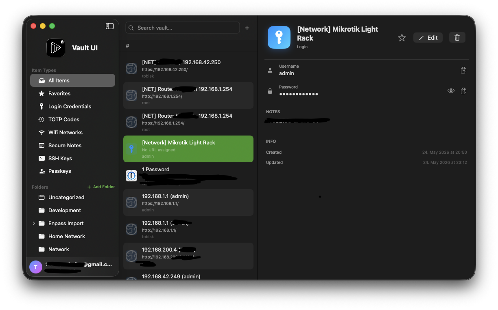
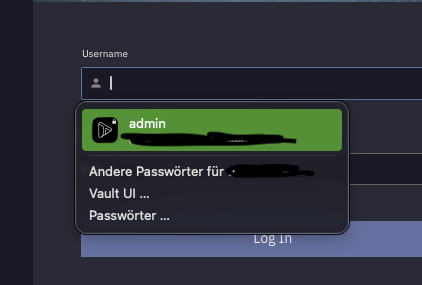
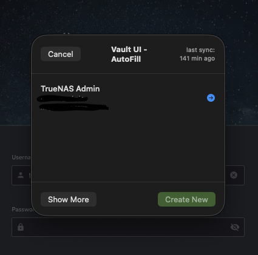
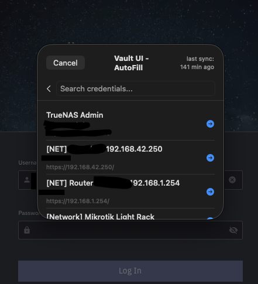
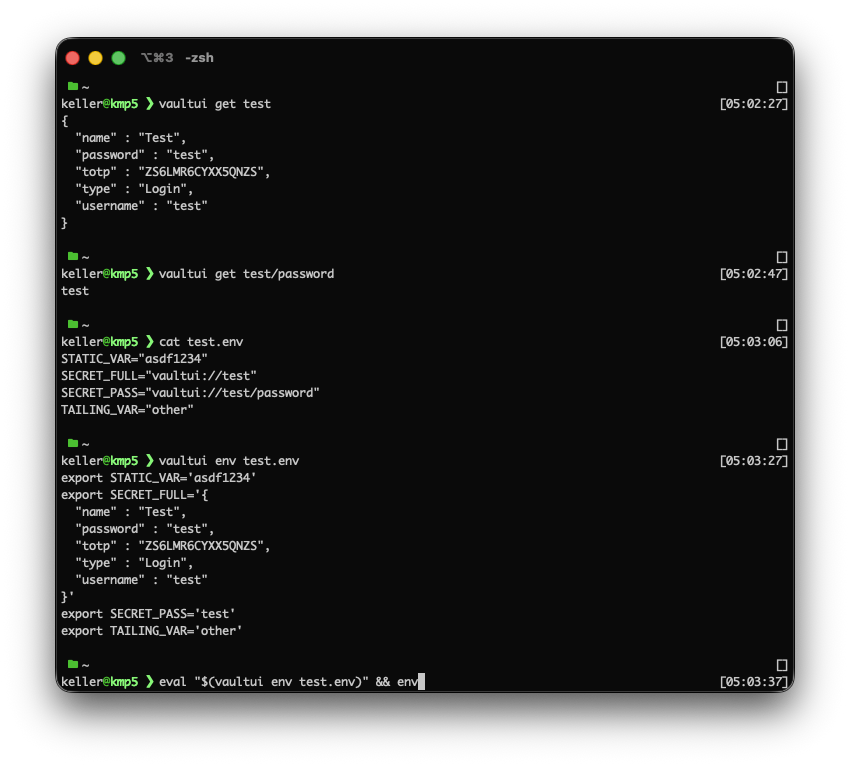
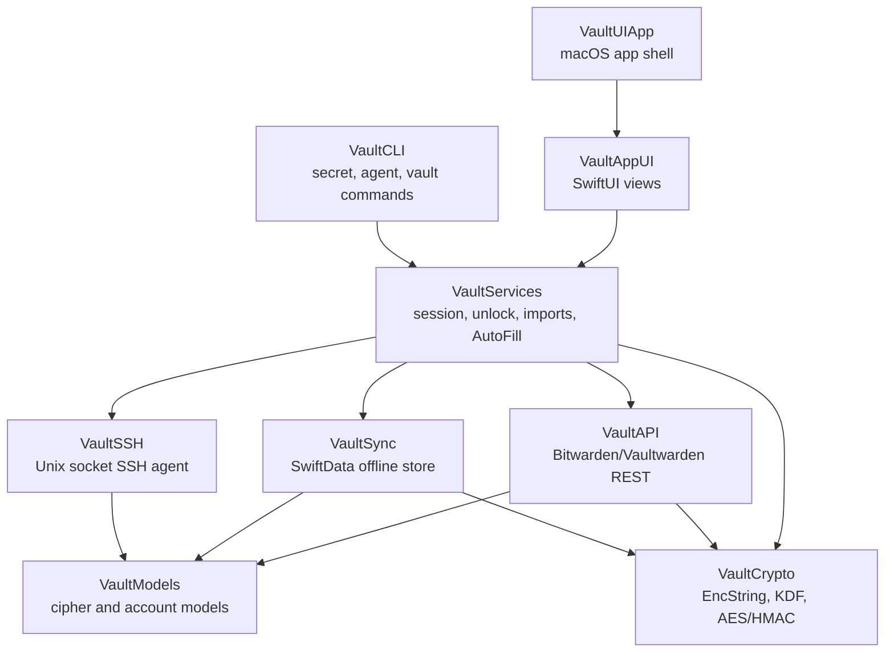

# Vault UI

Native macOS vault client for Bitwarden and Vaultwarden. Built with Swift 6, SwiftUI, SwiftData, CryptoKit, and a little bit of stubbornness.
Uses all available APIs for embedding it into the native OS workflows, such as AutoFill, TOTP Code Provider, Passkey Provider, SSH Key Agent, etc.



> [!WARNING]
> This project was substantially AI-coded and has not received an independent security audit. It handles passwords, passkeys, TOTP seeds, and SSH keys; use it at your own risk.

## What It Does

| Area | Status |
|------|--------|
| Native vault browser for logins, notes, cards, identities, SSH keys, Wi-Fi, passkeys, and Sends | Complete |
| Bitwarden/Vaultwarden sync with encrypted local SwiftData storage | Complete |
| AES-256-CBC + HMAC-SHA256 vault crypto, PBKDF2-SHA256, and Argon2id | Complete |
| Touch ID unlock with Keychain-backed vault key storage | Complete |
| macOS AutoFill credential provider for Safari and system password fields | Mostly Complete |
| Safari Web Extension message bridge | Mostly Complete |
| CLI secret lookup and `.env` hydration | Complete |
| SSH agent over a Unix socket for Ed25519 and RSA keys | Complete |
| Touch ID-gated secrets for local AI agents and automation | Complete |

## Screenshots

### macOS AutoFill

Native AutoFill suggestions appear directly in credential fields.

<p>
  
</p>

The custom AutoFill picker can show the best match immediately, or search the full vault when needed.

<p>
  
  
</p>

### CLI Secrets

The `vaultui` CLI can read a single secret, fetch one field, or expand `vaultui://` references inside env files.
It asks for your TouchID when it needs to access secrets and you can configure how long after the last use of the secrets, they stay unlocked.

Also provides an SSH Key Agent with the same mechanic.



## Highlights

- **Native app experience:** SwiftUI UI, macOS sidebar/detail layout, system settings integration, Touch ID unlock, and native AutoFill surfaces.
- **Bitwarden-compatible crypto:** EncString parsing, AES-CBC/HMAC, master key derivation, organization key handling, and authenticated encryption checks.
- **Offline-first vault:** encrypted local persistence via SwiftData, sync scheduling, and conflict-aware update flow.
- **Developer workflows:** CLI secret lookup, env hydration, TOTP generation, SSH agent support, and app-group IPC.
- **Agent-era guardrails:** AI agents can work with `vaultui://` env references and SSH agent sockets without receiving standing plaintext secrets; Touch ID is still required when a locked vault must release sensitive material.
- **Configurable signing:** bundle IDs, App Groups, Keychain groups, and Apple Team IDs are centralized in `Config/Signing.xcconfig`.

## Built For Local Agents

Unrestricted local coding agents are powerful, but they make old-school `.env` files and raw SSH keys feel a little too available. Vault UI is designed around a narrower handoff:

- Keep env files checked in or shared as templates with `vaultui://project.secret/field` references instead of plaintext values.
- Let build scripts resolve those references with `vaultui env .env` only when the app is running and the vault can authorize access.
- Point `SSH_AUTH_SOCK` at Vault UI's SSH agent so tools can use vault-backed SSH keys without copying private keys onto disk.
- When the vault is locked, sensitive release paths go back through Touch ID, so an AI agent can prepare work but cannot silently unlock credentials on its own.

## Build

### Requirements

- macOS 15 or newer
- Xcode 16 or newer
- Swift 6
- `xcodegen`
- Paid Apple Developer Program account for the AutoFill Credential Provider entitlement

Install XcodeGen:

```bash
brew install xcodegen
```

Configure signing in `Config/Signing.xcconfig`:

```xcconfig
VAULTUI_DEVELOPMENT_TEAM = YOUR_TEAM_ID
VAULTUI_BUNDLE_ID = com.yourname.vaultui
VAULTUI_AUTOFILL_BUNDLE_ID = $(VAULTUI_BUNDLE_ID).AutoFillExtension
VAULTUI_SAFARI_BUNDLE_ID = $(VAULTUI_BUNDLE_ID).SafariExtension
VAULTUI_APP_GROUP = group.$(VAULTUI_BUNDLE_ID)
VAULTUI_KEYCHAIN_GROUP = $(VAULTUI_BUNDLE_ID).shared
```

Generate and open the Xcode project:

```bash
xcodegen generate
open VaultUI.xcodeproj
```

Build and run with Xcode.

> [!NOTE]
> SwiftData `@Model` macros require Xcode for this project. Plain `swift build` is useful for individual non-SwiftData modules, but the full app should be built in Xcode.

## CLI

Build the CLI:

```bash
swift build --target VaultCLI
.build/debug/vaultui --help
```

Examples:

```bash
# Fetch a full item as JSON
vaultui get github.com --server https://vault.example.com --email user@example.com

# Fetch a single field
vaultui secret get my-app.database/password

# Expand vaultui:// references in an env file
eval "$(vaultui env .env)" && ./my-app

# SSH agent
vaultui agent start
export SSH_AUTH_SOCK="$HOME/Library/Group Containers/<your-app-group>/.vaultui/agent.sock"
```

See [CLI Secrets](docs/cli-secrets.md) for the full secret lookup and env hydration flow.

## Security Model

| Mechanism | Implementation |
|-----------|----------------|
| Vault encryption | AES-256-CBC with HMAC-SHA256, encrypt-then-MAC |
| Key derivation | PBKDF2-HMAC-SHA256 with a 100,000 iteration floor, or Argon2id |
| Key stretching | HKDF expand into encryption and MAC keys |
| Token storage | macOS Keychain, this-device-only accessibility |
| Touch ID unlock | Keychain item protected with `biometryCurrentSet` |
| Local data | encrypted vault blobs in SwiftData; plaintext only in memory while unlocked |
| Legacy encrypted strings | unauthenticated type 0 EncStrings are rejected |
| Randomness | `SecRandomCopyBytes` with rejection sampling for password generation |

This is a personal/open source implementation, not a formally audited password manager. Review the code, understand the risks, and keep backups before trusting it with important vaults.

## Credential Matching

When AutoFill is asked to fill a page or app, Vault UI has to decide which stored
logins are a match for the requesting site. Getting this wrong is a phishing risk
(a look-alike domain must never be offered a credential), so matching is decided
on three independent, boundary-aware checks rather than a loose substring compare.

Both the stored credential URI and the requesting site are deconstructed into
**scheme**, **host**, and **path**, and a URI is considered a match only if **all
three** rules pass:

### 1. Domain

The site's host must **equal** the credential's domain, or be a **proper
subdomain** of it (matched on a label boundary, never a raw string suffix).

| Credential URI | Requesting site | Match? |
|----------------|-----------------|--------|
| `example.com` | `example.com` | ✅ exact |
| `example.com` | `auth.example.com` | ✅ subdomain |
| `blog.example.com` | `auth.example.com` | ❌ not a subdomain of `blog.example.com` |
| `paypal.com` | `paypal.com.evil.com` | ❌ different registrable domain |
| `paypal.com` | `paypal.com@evil.com` | ❌ userinfo is stripped; host is `evil.com` |

A leading `*.` wildcard (e.g. `*.example.com`) is supported and matches the base
domain and any subdomain.

### 2. Protocol

Checked only once the domain matches. The site's scheme must be **as secure as, or
more secure than**, the credential's scheme:

| Credential scheme | Requesting site scheme | Allowed? |
|-------------------|------------------------|----------|
| `http` | `http` or `https` | ✅ |
| `https` | `https` | ✅ |
| `https` | `http` | ❌ downgrade blocked |
| none (e.g. `example.com`, `://example.com`) | any | ✅ |

If the request is a domain-only identifier with no scheme to inspect, the protocol
check is skipped (there is nothing to downgrade).

### 3. Path

Checked only once domain and protocol match. If the credential pins a path, the
site's path must be that exact path or a sub-path of it (matched on a path-segment
boundary). A credential with no path — or just `/` — matches any path.

| Credential URI | Requesting site | Match? |
|----------------|-----------------|--------|
| `example.com` | `example.com/anything` | ✅ no pinned path |
| `example.com/app` | `example.com/app/home` | ✅ sub-path |
| `example.com/app` | `example.com/application` | ❌ not a segment boundary |
| `example.com/app` | `example.com/other` | ❌ different path |

Matches are then ranked — exact URI > exact host > subdomain — so the closest match
is offered first in the AutoFill picker.

> [!NOTE]
> This describes the macOS AutoFill credential provider matcher. The Safari Web
> Extension bridge uses a separate, simpler matcher.

## Architecture



| Module | Purpose |
|--------|---------|
| `VaultCrypto` | Bitwarden-compatible cryptographic primitives and EncString handling |
| `VaultModels` | Codable vault models for ciphers, logins, cards, folders, Sends, passkeys, and accounts |
| `VaultAPI` | authentication, token refresh, sync, CRUD, and attachment APIs |
| `VaultSync` | encrypted local persistence and offline sync state |
| `VaultSSH` | SSH agent server and signing handlers |
| `VaultServices` | session orchestration, Keychain storage, imports, AutoFill, Safari extension logic, CLI secret agent |
| `VaultAppUI` | SwiftUI app views, settings, item browser, editors, importers, and generator UI |
| `VaultCLI` | command-line interface built with `swift-argument-parser` |

## Apple Account Setup

The project is set up so each developer can bring their own Apple account without rewriting source files. Edit only `Config/Signing.xcconfig`, then regenerate the Xcode project.

See [Configuring Your Apple Developer Account](docs/ON_DEVELOPER_TRANSFER.md) and [Building Vault UI](BUILDING.md) for the longer checklist.

## Dependencies

| Package | Purpose | License |
|---------|---------|---------|
| [swift-crypto](https://github.com/apple/swift-crypto) | HMAC, HKDF, Curve25519, cryptographic support | Apache-2.0 |
| [swift-nio](https://github.com/apple/swift-nio) | Unix socket servers for agents | Apache-2.0 |
| [swift-argument-parser](https://github.com/apple/swift-argument-parser) | CLI parsing | Apache-2.0 |
| [Argon2Swift](https://github.com/tmthecoder/Argon2Swift) | Argon2id KDF support | MIT |

Full notices are available in [THIRD_PARTY_LICENSES.md](Sources/VaultAppUI/Resources/THIRD_PARTY_LICENSES.md) and inside the app under Settings -> Licenses.

## License

Vault UI is released under the MIT License. See [LICENSE](LICENSE).
