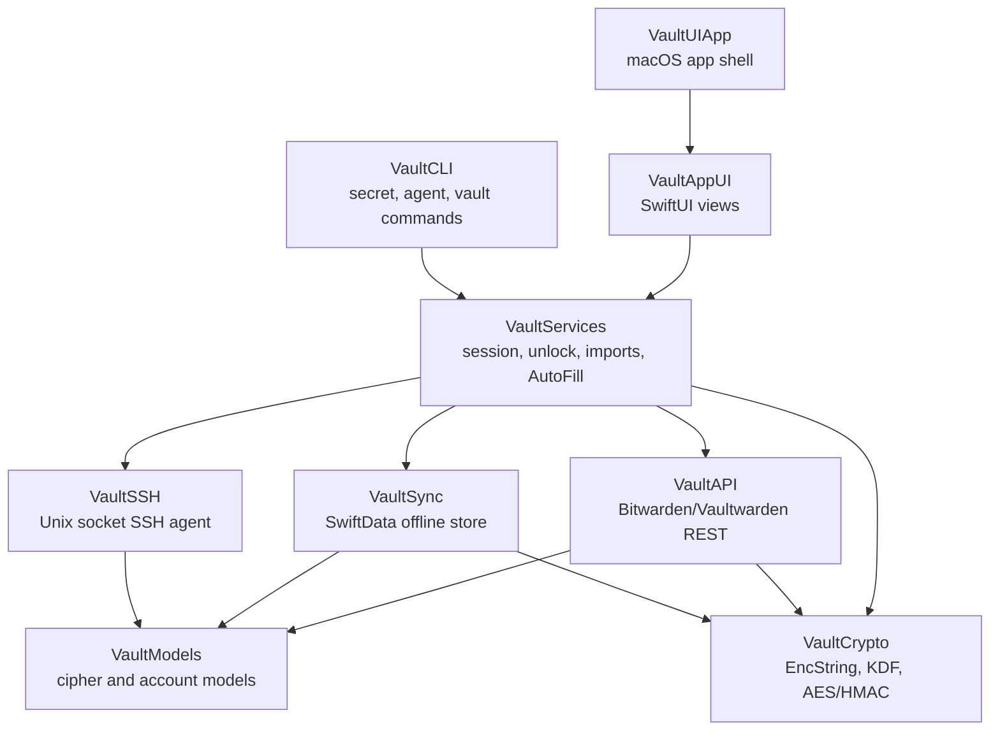

# Vault UI

Native macOS vault client for Bitwarden and Vaultwarden. Built with Swift 6, SwiftUI, SwiftData, CryptoKit, and a little bit of stubbornness.

No Electron. No cloud proxy. No server-side plaintext.


> [!WARNING]
> This project was substantially AI-coded and has not received an independent security audit. It handles passwords, passkeys, TOTP seeds, and SSH keys; use it at your own risk.

## What It Does

| Area | Status |
|------|--------|
| Native vault browser for logins, notes, cards, identities, SSH keys, Wi-Fi, passkeys, and Sends | Complete |
| Bitwarden/Vaultwarden sync with encrypted local SwiftData storage | Complete |
| AES-256-CBC + HMAC-SHA256 vault crypto, PBKDF2-SHA256, and Argon2id | Complete |
| Touch ID unlock with Keychain-backed vault key storage | Complete |
| macOS AutoFill credential provider for Safari and system password fields | Working |
| Safari Web Extension message bridge | Partial |
| CLI secret lookup and `.env` hydration | Complete |
| SSH agent over a Unix socket for Ed25519 and RSA keys | Complete |

## Screenshots

### macOS AutoFill

Native AutoFill suggestions appear directly in credential fields.

<p>
  
</p>

The custom AutoFill picker can show the best match immediately, or search the full vault when needed.

<p>
  
  
</p>

### CLI Secrets

The `vaultui` CLI can read a single secret, fetch one field, or expand `vaultui://` references inside env files.


## Highlights

- **Native app experience:** SwiftUI UI, macOS sidebar/detail layout, system settings integration, Touch ID unlock, and native AutoFill surfaces.
- **Bitwarden-compatible crypto:** EncString parsing, AES-CBC/HMAC, master key derivation, organization key handling, and authenticated encryption checks.
- **Offline-first vault:** encrypted local persistence via SwiftData, sync scheduling, and conflict-aware update flow.
- **Developer workflows:** CLI secret lookup, env hydration, TOTP generation, SSH agent support, and app-group IPC.
- **Configurable signing:** bundle IDs, App Groups, Keychain groups, and Apple Team IDs are centralized in `Config/Signing.xcconfig`.

## Build

### Requirements

- macOS 15 or newer
- Xcode 16 or newer
- Swift 6
- `xcodegen`
- Paid Apple Developer Program account for the AutoFill Credential Provider entitlement

Install XcodeGen:

```bash
brew install xcodegen
```

Configure signing in `Config/Signing.xcconfig`:

```xcconfig
VAULTUI_DEVELOPMENT_TEAM = YOUR_TEAM_ID
VAULTUI_BUNDLE_ID = com.yourname.vaultui
VAULTUI_AUTOFILL_BUNDLE_ID = $(VAULTUI_BUNDLE_ID).AutoFillExtension
VAULTUI_SAFARI_BUNDLE_ID = $(VAULTUI_BUNDLE_ID).SafariExtension
VAULTUI_APP_GROUP = group.$(VAULTUI_BUNDLE_ID)
VAULTUI_KEYCHAIN_GROUP = $(VAULTUI_BUNDLE_ID).shared
```

Generate and open the Xcode project:

```bash
xcodegen generate
open VaultUI.xcodeproj
```

Build and run with Xcode.

> [!NOTE]
> SwiftData `@Model` macros require Xcode for this project. Plain `swift build` is useful for individual non-SwiftData modules, but the full app should be built in Xcode.

## CLI

Build the CLI:

```bash
swift build --target VaultCLI
.build/debug/vaultui --help
```

Examples:

```bash
# Fetch a full item as JSON
vaultui get github.com --server https://vault.example.com --email user@example.com

# Fetch a single field
vaultui secret get my-app.database/password

# Expand vaultui:// references in an env file
eval "$(vaultui env .env)" && ./my-app

# SSH agent
vaultui agent start
export SSH_AUTH_SOCK="$HOME/Library/Group Containers/<your-app-group>/.vaultui/agent.sock"
```

See [CLI Secrets](docs/cli-secrets.md) for the full secret lookup and env hydration flow.

## Security Model

| Mechanism | Implementation |
|-----------|----------------|
| Vault encryption | AES-256-CBC with HMAC-SHA256, encrypt-then-MAC |
| Key derivation | PBKDF2-HMAC-SHA256 with a 100,000 iteration floor, or Argon2id |
| Key stretching | HKDF expand into encryption and MAC keys |
| Token storage | macOS Keychain, this-device-only accessibility |
| Touch ID unlock | Keychain item protected with `biometryCurrentSet` |
| Local data | encrypted vault blobs in SwiftData; plaintext only in memory while unlocked |
| Legacy encrypted strings | unauthenticated type 0 EncStrings are rejected |
| Randomness | `SecRandomCopyBytes` with rejection sampling for password generation |

This is a personal/open source implementation, not a formally audited password manager. Review the code, understand the risks, and keep backups before trusting it with important vaults.

## Architecture



| Module | Purpose |
|--------|---------|
| `VaultCrypto` | Bitwarden-compatible cryptographic primitives and EncString handling |
| `VaultModels` | Codable vault models for ciphers, logins, cards, folders, Sends, passkeys, and accounts |
| `VaultAPI` | authentication, token refresh, sync, CRUD, and attachment APIs |
| `VaultSync` | encrypted local persistence and offline sync state |
| `VaultSSH` | SSH agent server and signing handlers |
| `VaultServices` | session orchestration, Keychain storage, imports, AutoFill, Safari extension logic, CLI secret agent |
| `VaultAppUI` | SwiftUI app views, settings, item browser, editors, importers, and generator UI |
| `VaultCLI` | command-line interface built with `swift-argument-parser` |

## Apple Account Setup

The project is set up so each developer can bring their own Apple account without rewriting source files. Edit only `Config/Signing.xcconfig`, then regenerate the Xcode project.

See [Configuring Your Apple Developer Account](docs/ON_DEVELOPER_TRANSFER.md) and [Building Vault UI](BUILDING.md) for the longer checklist.

## Dependencies

| Package | Purpose | License |
|---------|---------|---------|
| [swift-crypto](https://github.com/apple/swift-crypto) | HMAC, HKDF, Curve25519, cryptographic support | Apache-2.0 |
| [swift-nio](https://github.com/apple/swift-nio) | Unix socket servers for agents | Apache-2.0 |
| [swift-argument-parser](https://github.com/apple/swift-argument-parser) | CLI parsing | Apache-2.0 |
| [Argon2Swift](https://github.com/tmthecoder/Argon2Swift) | Argon2id KDF support | MIT |

Full notices are available in [THIRD_PARTY_LICENSES.md](Sources/VaultAppUI/Resources/THIRD_PARTY_LICENSES.md) and inside the app under Settings -> Licenses.

## License

Vault UI is released under the MIT License. See [LICENSE](LICENSE).
